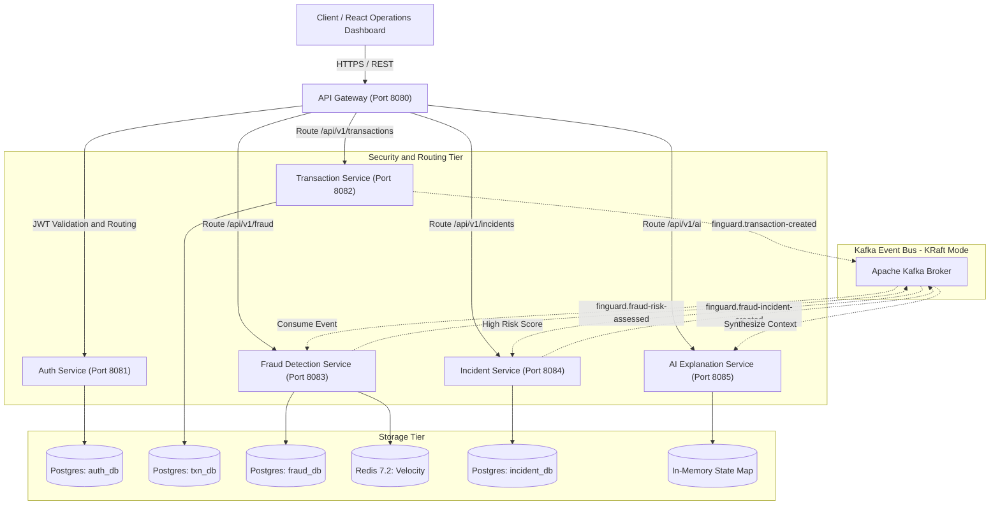
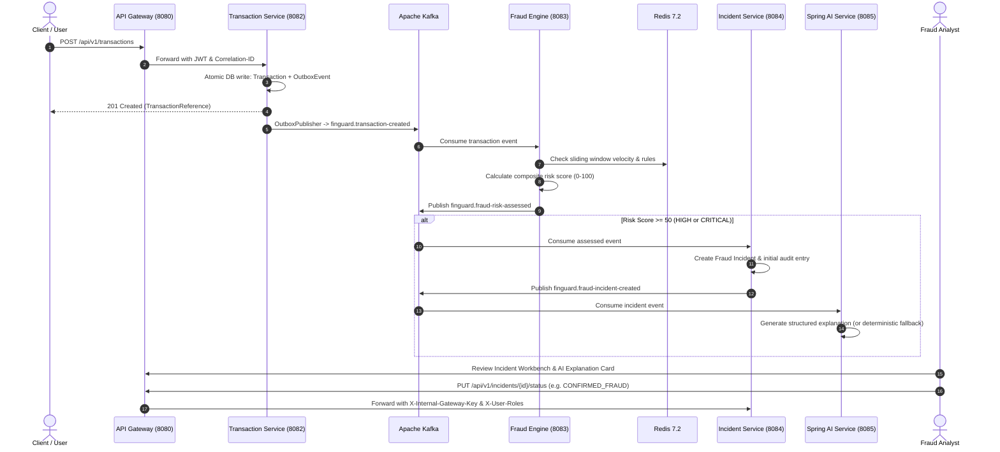

# FinGuard – Financial Transaction Monitoring & Fraud Intelligence Platform

[](https://openjdk.org/)
[](https://spring.io/projects/spring-boot)
[](https://spring.io/projects/spring-cloud)
[](https://kafka.apache.org/)
[](https://redis.io/)
[](https://spring.io/projects/spring-ai)
[](https://www.postgresql.org/)
[](https://react.dev/)
[](https://github.com/siddhikhalate/finguard-platform/actions/workflows/ci.yml)
[](LICENSE)

FinGuard is an event-driven financial transaction monitoring and fraud detection portfolio project built with synthetic data. Built using **Java 21**, **Spring Boot 3.3.5**, **Apache Kafka (KRaft mode)**, **Redis**, **PostgreSQL**, **Spring AI**, and **React 18**, it demonstrates core microservice patterns including the **Transactional Outbox Pattern** in the transaction service, **Sliding-Window Velocity Tracking** in Redis, **Rule-Based Fraud Scoring**, and **AI-Assisted Incident Explanations** with deterministic fallback support.

---

## 🌐 Live Demo

UI demo at https://finguard-platform.vercel.app/ runs on built-in sample data (demo mode). The full backend runs locally with Docker Compose.

---

## 🏛️ System Architecture



---

## ⚡ Real-Time Transaction & Fraud Lifecycle



---

## 🧩 Microservices Topology & Responsibilities

| Service | Port | Database / State | Key Responsibilities |
| :--- | :---: | :--- | :--- |
| **API Gateway** | `8080` | Stateless (Netty) | Single entry point, CORS management, Correlation ID injection (`X-Correlation-ID`), JWT Bearer token claims forwarding. |
| **Auth Service** | `8081` | `auth_db` | User registration, authentication, BCrypt password hashing, JJWT token issuance, RBAC (`ROLE_USER`, `ROLE_ANALYST`, `ROLE_ADMIN`). |
| **Transaction Service** | `8082` | `txn_db` | Account ledger, balance validation, idempotency key deduplication, atomic Transactional Outbox event generation. |
| **Fraud Detection Service** | `8083` | `fraud_db` + Redis | Kafka event consumer, pluggable Strategy rule evaluations, Redis sliding-window velocity tracker, composite scoring. |
| **Incident Management Service** | `8084` | `incident_db` | Auto-incident triage for scores $\ge 50$, status updates with transition audit logging (`IncidentAuditLog`). |
| **AI Explanation Service** | `8085` | In-Memory State Map | Spring AI LLM integration with deterministic fallback engine; explanations cached in memory (`ConcurrentHashMap`). |
| **React Dashboard** | `5173` / `3000` | Local Storage | Real-time Operations Console, Transaction Management Hub, Risk Heatmap, Incident Investigation Workbench, Rule Config. |

---

## 🛡️ Deterministic Fraud Rules Engine

FinGuard follows the **Assistive AI Principle**: Automated financial or legal verdicts are never delegated solely to non-deterministic LLMs. Instead, the deterministic Fraud Rules Engine evaluates four configurable strategies:

| Strategy | Rule Key | Default Weight | Trigger Condition |
| :--- | :--- | :---: | :--- |
| **High Amount** | `HIGH_AMOUNT` | **+25** | Transaction amount $>$ configured threshold (Default: `$10,000.00`). |
| **Rapid Activity** | `RAPID_ACTIVITY` | **+25** | Redis sliding window detects $> 3$ transactions (4 or more) within a 120-second rolling window for the same account (default threshold: 3, window: 120s). |
| **Unusual Location** | `UNUSUAL_LOCATION` | **+20** | Transaction location matches a hardcoded set of synthetic high-risk location keywords (`LAGOS, NIGERIA`, `CAYMAN ISLANDS`, `UNKNOWN PROXY`, `TOR EXIT NODE`, `OFFSHORE HAVEN`). |
| **Repeated Failures** | `REPEATED_FAILURES` | **+15** | Flags transactions with status `FAILED` (e.g. insufficient balance) when rolling failures $\ge 1$ within a 300-second window (default threshold: 1, window: 300s). |

### Risk Classification Tiers:
- **`LOW` (0 – 24 pts):** Green badge. Standard legitimate activity.
- **`MEDIUM` (25 – 49 pts):** Blue badge. Heightened monitoring; non-blocking.
- **`HIGH` (50 – 74 pts):** Amber badge. Triggers automated Fraud Incident for human analyst review.
- **`CRITICAL` (75 – 100 pts):** Rose badge. Immediate high-priority incident triage and account hold recommendation.

---

## 🤖 Spring AI & Deterministic Fallback Engine

The AI Explanation Service consumes `finguard.fraud-incident-created` and synthesizes multi-dimensional transaction factors into human-readable analyst briefs.

```json
{
  "incidentId": "8f2d5e1a-4c3b-4a5f-9e8d-1a2b3c4d5e6f",
  "transactionId": "7a1b2c3d-4e5f-6a7b-8c9d-0e1f2a3b4c5d",
  "summary": "Transaction of 25000.00 USD was classified as CRITICAL risk (Score: 85/100). Evaluation triggered 3 compliance rule(s): High Transaction Amount, Rapid Account Velocity, Unusual Location.",
  "factors": [
    "[HIGH_AMOUNT] High Transaction Amount (+25 pts) - Transaction amount of $25,000.00 exceeds threshold of $10,000.00",
    "[RAPID_ACTIVITY] Rapid Account Velocity (+25 pts) - 4 transactions detected in 120s window",
    "[UNUSUAL_LOCATION] Unusual Location (+20 pts) - Location matches high-risk identifier"
  ],
  "recommendedActions": [
    "Immediately execute temporary debit freeze on the cardholder account.",
    "Initiate out-of-band verification (SMS OTP / Push notification) with cardholder.",
    "Cross-reference recipient account against internal financial sanctions and anti-money laundering (AML) watchlists."
  ],
  "confidenceLevel": "HIGH",
  "modelUsed": "gpt-4o-mini",
  "isFallback": false,
  "generatedAt": "2026-11-20T12:00:00Z"
}
```

### Deterministic Fallback Engine:
If the LLM provider experiences network timeouts, rate limiting, or if no API key is configured, the `DeterministicFallbackExplainer` generates a rule-grounded briefing from the triggered fraud indicators so explanation requests still return structured findings.

---

## 🗄️ Database Architecture & Flyway Migrations

Relational microservices maintain dedicated PostgreSQL databases with Flyway migrations. The AI Explanation Service does not use a database and stores explanations in an in-memory concurrent map:

- **`auth_db`:** `users`, `roles`, `user_roles`, `refresh_tokens`.
- **`txn_db`:** `accounts`, `transactions`, `outbox_events`.
- **`fraud_db`:** `fraud_rules`, `risk_assessments`, `triggered_rules`.
- **`incident_db`:** `fraud_incidents`, `incident_audit_logs`.
- **AI Explanations:** Stored in-memory in `AiExplanationService` via `ConcurrentHashMap` (no persistent database).

---

## 🚀 Quickstart & Setup Guide

### Prerequisites
- **Java 21** or higher
- **Node.js 20+** and **npm**
- **Docker Desktop** & **Docker Compose**
- **Git**

### 1. Clone & Prepare Environment

```bash
git clone https://github.com/siddhikhalate/finguard-platform.git
cd finguard-platform
```

**Copy environment configuration:**

On Windows (PowerShell / CMD):
```powershell
copy .env.example .env
```

On Linux / macOS:
```bash
cp .env.example .env
```

### 2. Start Infrastructure Containers
Start PostgreSQL 16, Redis 7.2, Apache Kafka (KRaft mode), and Kafka UI:
```bash
docker compose up -d postgres redis kafka kafka-ui
```
*Kafka UI will be available at [http://localhost:8090](http://localhost:8090) to view topics and event streams.*

### 3. Run Automated Tests
Execute the test suite across all services:
```bash
# On Windows PowerShell:
.\mvnw.cmd test

# On Linux/macOS:
./mvnw test
```
*Result: 46 automated unit tests execute successfully.*

### 4. Run Backend Services
Build application packages:
```bash
# On Windows PowerShell:
.\mvnw.cmd clean package -DskipTests

# On Linux/macOS:
./mvnw clean package -DskipTests
```

You can run services individually from your IDE or via terminal:
```bash
# 1. API Gateway (Port 8080)
java -jar api-gateway/target/api-gateway-1.0.0-SNAPSHOT.jar

# 2. Auth Service (Port 8081)
java -jar auth-service/target/auth-service-1.0.0-SNAPSHOT.jar

# 3. Transaction Service (Port 8082)
java -jar transaction-service/target/transaction-service-1.0.0-SNAPSHOT.jar

# 4. Fraud Detection Service (Port 8083)
java -jar fraud-detection-service/target/fraud-detection-service-1.0.0-SNAPSHOT.jar

# 5. Incident Management Service (Port 8084)
java -jar incident-service/target/incident-service-1.0.0-SNAPSHOT.jar

# 6. AI Explanation Service (Port 8085)
java -jar ai-explanation-service/target/ai-explanation-service-1.0.0-SNAPSHOT.jar
```

*Docker Note:*
Docker image builds for the application services are being fixed; run the services from the jars above.

### 5. Launch React Dashboard
```bash
cd frontend
npm install
npm run dev
```
Open [http://localhost:5173](http://localhost:5173) in your browser.

**Development Quick-Login Credentials (`dev` profile):**
- **Admin:** `dev_admin` / `DevAdmin@123`
- **Analyst:** `dev_analyst` / `DevAnalyst@123`
- **Standard User:** `dev_user` / `DevUser@123`

> **Note on Environment Scope:** These pre-seeded dev accounts are created exclusively when running with the `dev` profile (run the services with SPRING_PROFILES_ACTIVE=dev to create them) via `DevDataInitializer`. They exist solely for local development and testing. In non-dev profiles, no default credentials are created and accounts register via `/api/v1/auth/register`.

---

## 🧪 Automated Unit Test Verification

The test suite consists of **46 unit tests** built with **JUnit 5** and **Mockito** across 6 service modules. (Integration tests using Testcontainers or embedded Kafka are not yet implemented).

| Module | Test Class | Tests Run | Result |
| :--- | :--- | :---: | :---: |
| `auth-service` | `InternalGatewayAuthFilterTest` | 4 | ✅ Passed |
| `auth-service` | `JwtTokenProviderTest` | 3 | ✅ Passed |
| `auth-service` | `AuthServiceTest` | 7 | ✅ Passed |
| `api-gateway` | `CorsConfigTest` | 1 | ✅ Passed |
| `api-gateway` | `JwtAuthenticationFilterTest` | 6 | ✅ Passed |
| `api-gateway` | `JwtUtilsTest` | 1 | ✅ Passed |
| `transaction-service` | `InternalGatewayAuthFilterTest` | 4 | ✅ Passed |
| `transaction-service` | `TransactionServiceTest` | 7 | ✅ Passed |
| `fraud-detection-service` | `FraudRuleEngineTest` | 3 | ✅ Passed |
| `fraud-detection-service` | `FraudDetectionServiceTest` | 2 | ✅ Passed |
| `incident-service` | `IncidentServiceTest` | 4 | ✅ Passed |
| `ai-explanation-service` | `DeterministicFallbackExplainerTest` | 2 | ✅ Passed |
| `ai-explanation-service` | `AiExplanationServiceTest` | 2 | ✅ Passed |
| **Total** | **6 Service Modules** | **46** | **✅ 100% PASS** |

---

## 📐 Design Decisions

1. **Transactional Outbox in Transaction Service:**
   - To avoid dual-write inconsistency between PostgreSQL and Kafka, `transaction-service` writes the transaction ledger record and an `OutboxEvent` inside the same database transaction. A background scheduler (`OutboxPublisher`) polls pending outbox entries and publishes them to Kafka with at-least-once delivery semantics.
2. **Direct Kafka Publishing in Downstream Services:**
   - Downstream services (`fraud-detection-service` and `incident-service`) publish events to Kafka directly via `KafkaTemplate` upon event completion (no outbox pattern is implemented in those services).
3. **Kafka Reliability & Messaging Model:**
   - Event delivery from `transaction-service` guarantees at-least-once delivery through polling retries of pending outbox records.
   - Message order is preserved per account on `finguard.transaction-created` by using `accountId` as the partition key.
   - Downstream services use direct `KafkaTemplate` publishing without dead-letter topics (DLT) or automatic retry topics.
   - Idempotency is enforced at ingestion in `transaction-service` through database-backed idempotency keys; consumers do not use distributed transactions or exactly-once processing guarantees.
4. **Rule-Based Scoring with Assistive AI:**
   - Fraud risk scoring is 100% deterministic, calculated by rule strategies in `fraud-detection-service`. The AI Explanation Service does not assign scores or block transactions; it strictly generates natural language explanation narratives from triggered rule metadata.

---

## 🔒 Security Implementation

- **API Gateway Perimeter Enforcement:** `JwtAuthenticationFilter` validates incoming JWTs, enforces the role matrix (`ROLE_USER`, `ROLE_ANALYST`, `ROLE_ADMIN`), strips spoofable client headers (`X-User-*`), and attaches a shared `X-Internal-Gateway-Key`.
- **Microservice Isolation:** Downstream services verify the internal gateway key in constant time via `MessageDigest.isEqual(...)` before processing requests, preventing perimeter bypass.
- **Object-Level Access Control:** `transaction-service` enforces account ownership so users with `ROLE_USER` can only access accounts tied to their `userId`, while compliance analysts and admins retain cross-account audit access.
- **Authentication & Credential Hardening:** Passwords hashed with BCrypt; JWTs validated at the gateway. Login lockout and refresh-token hashing are work in progress (see Known Limitations).

---

## ⚠️ Known Limitations

- **Auth Hardening In Progress:** The failed-login lockout counter and refresh-token hashing are not yet fully reliable; refresh tokens are still stored alongside their hash.
- **Outbox Scope:** Implemented only in `transaction-service`. Downstream services (`fraud-detection-service`, `incident-service`) publish directly to Kafka via `KafkaTemplate`.
- **No Dead-Letter Topics (DLT):** Unprocessable Kafka messages or consumer exceptions do not route to a dead-letter queue.
- **Unit Tests Only:** Test coverage consists of unit tests (JUnit 5 + Mockito); no integration tests using Testcontainers or embedded Kafka are currently present.
- **Static High-Risk Location List:** The unusual location rule checks a hardcoded list of synthetic location keywords in `UnusualLocationRuleStrategy` rather than a dynamic per-customer geographical baseline.
- **Client Token Storage:** Authentication JWTs are stored in browser `localStorage`.
- **Synthetic Data Heuristics:** Designed as an educational portfolio architecture using synthetic banking transactions rather than a real bank cardholder dataset or machine learning fraud model.
- **Deterministic AI Fallback:** When an OpenAI API key is not configured or reachable, `ai-explanation-service` automatically falls back to template-based deterministic explanations.

---

## 🚀 Future Improvements

- **Integration Testing:** Add automated integration test suites with Testcontainers for PostgreSQL, Kafka, and Redis.
- **Kafka Dead-Letter Topics:** Configure Dead Letter Topics (DLT) and error-handling deserializers for resilient consumer recovery.
- **Universal Outbox Pattern:** Implement the Transactional Outbox pattern across `fraud-detection-service` and `incident-service`.
- **Pessimistic Balance Locking:** Introduce database-level pessimistic locking (`SELECT FOR UPDATE`) on account balances during high-concurrency transfers.
- **Dynamic Geographic Baselining:** Replace hardcoded location checks with historical per-account velocity and geolocation profiles.
- **Hosted Cloud Backend:** Containerize and deploy the Spring Boot microservices on Kubernetes or managed cloud container services.

---

## 📄 License
This project is licensed under the MIT License - see the [LICENSE](LICENSE) file for details.
