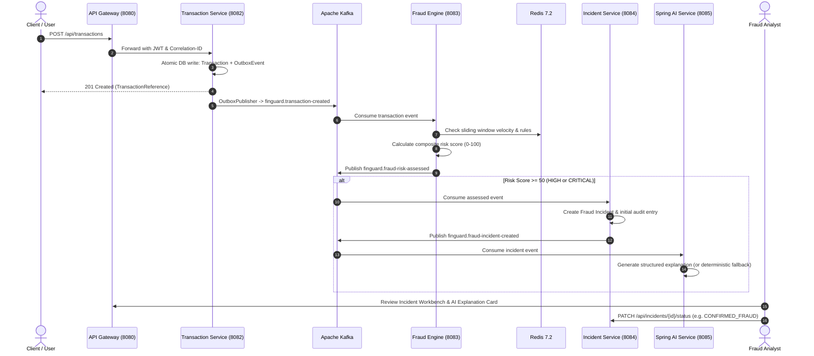

# FinGuard – Enterprise Financial Transaction Monitoring & Fraud Intelligence Platform

[](https://openjdk.org/)
[](https://spring.io/projects/spring-boot)
[](https://spring.io/projects/spring-cloud)
[](https://kafka.apache.org/)
[](https://redis.io/)
[](https://spring.io/projects/spring-ai)
[](https://www.postgresql.org/)
[](https://react.dev/)
[](https://github.com)
[](LICENSE)

FinGuard is a production-grade, event-driven financial transaction monitoring and fraud detection platform designed for high-throughput banking environments. Built using **Java 21**, **Spring Boot 3.3.5**, **Apache Kafka (KRaft mode)**, **Redis**, **PostgreSQL**, **Spring AI**, and **React 18**, it demonstrates enterprise microservice patterns including the **Transactional Outbox Pattern**, **Sliding-Window Velocity Tracking**, **Deterministic Multi-Factor Fraud Scoring**, and **AI-Assisted Investigation with Bulletproof Fallback Resilience**.

---

## 🏛️ System Architecture

```mermaid
flowchart TD
    Client["Client / React Operations Dashboard"] -->|HTTPS / REST| Gateway["API Gateway (Port 8080)<br/>Spring Cloud Gateway + Netty"]
    
    subgraph Security & Routing
        Gateway -->|JWT Validation & Routing| AuthSvc["Auth Service (Port 8081)<br/>JJWT + BCrypt + Roles"]
        Gateway -->|Route /api/transactions| TxSvc["Transaction Service (Port 8082)<br/>Transactional Outbox"]
        Gateway -->|Route /api/fraud| FraudSvc["Fraud Detection Service (Port 8083)<br/>Rules Engine + Redis"]
        Gateway -->|Route /api/incidents| IncSvc["Incident Service (Port 8084)<br/>Triage & Audit Trail"]
        Gateway -->|Route /api/ai| AiSvc["AI Explanation Service (Port 8085)<br/>Spring AI + Fallback"]
    end

    subgraph Storage & Caching
        AuthSvc --> AuthDB[(Postgres: finguard_auth)]
        TxSvc --> TxDB[(Postgres: finguard_transactions)]
        FraudSvc --> FraudDB[(Postgres: finguard_fraud)]
        FraudSvc --> RedisCache[(Redis 7.2:<br/>Rules & Sliding Window)]
        IncSvc --> IncDB[(Postgres: finguard_incidents)]
        AiSvc --> AiDB[(Postgres: finguard_ai)]
    end

    subgraph Kafka Event Bus (KRaft Mode)
        TxSvc -.->|finguard.transaction-created| Kafka[Apache Kafka Broker]
        Kafka -.->|Consume Event| FraudSvc
        FraudSvc -.->|finguard.fraud-risk-assessed| Kafka
        Kafka -.->|Score >= 50| IncSvc
        IncSvc -.->|finguard.fraud-incident-created| Kafka
        Kafka -.->|Synthesize Context| AiSvc
    end
```

---

## ⚡ Real-Time Transaction & Fraud Lifecycle



---

## 🧩 Microservices Topology & Responsibilities

| Service | Port | Database / State | Key Responsibilities |
| :--- | :---: | :--- | :--- |
| **API Gateway** | `8080` | Stateless (Netty) | Single entry point, CORS management, Correlation ID injection (`X-Correlation-ID`), JWT Bearer token claims forwarding. |
| **Auth Service** | `8081` | `finguard_auth` | User registration, authentication, BCrypt password hashing, JJWT token issuance, RBAC (`ROLE_USER`, `ROLE_ANALYST`, `ROLE_ADMIN`). |
| **Transaction Service** | `8082` | `finguard_transactions` | Account ledger, balance validation, idempotency key deduplication, atomic Transactional Outbox event generation. |
| **Fraud Detection Service** | `8083` | `finguard_fraud` + Redis | Kafka event consumer, pluggable Strategy rule evaluations, Redis sliding-window velocity tracker, composite scoring. |
| **Incident Management Service** | `8084` | `finguard_incidents` | Auto-incident triage for scores $\ge 50$, state machine lifecycle (`NEW` $\rightarrow$ `UNDER_INVESTIGATION` $\rightarrow$ `RESOLVED`), audit logs. |
| **AI Explanation Service** | `8085` | `finguard_ai` | Spring AI LLM integration, structured natural language explanation, zero-downtime deterministic fallback engine. |
| **React Dashboard** | `5173` / `3000` | Local Storage | Real-time Operations Console, Transaction Management Hub, Risk Heatmap, Incident Investigation Workbench, Rule Config. |

---

## 🛡️ Deterministic Fraud Rules Engine

FinGuard follows the **Assistive AI Principle**: Automated financial or legal verdicts are never delegated solely to non-deterministic LLMs. Instead, the deterministic Fraud Rules Engine evaluates four configurable strategies:

| Strategy | Rule Key | Default Weight | Trigger Condition |
| :--- | :--- | :---: | :--- |
| **High Amount** | `HIGH_AMOUNT` | **+25** | Transaction amount $\ge$ configured threshold (Default: `$10,000.00`). |
| **Rapid Activity** | `RAPID_ACTIVITY` | **+25** | Redis sliding window detects $\ge 3$ transactions in a 60-second window for the same account. |
| **Unusual Location** | `UNUSUAL_LOCATION` | **+20** | Inbound transaction location departs from customer baseline geographical history. |
| **Repeated Failures** | `REPEATED_FAILURES` | **+15** | Prior failed PIN / authentication retries recorded within recent window $\ge 2$. |

### Risk Classification Tiers:
- **`LOW` (0 – 24 pts):** Green badge. Standard legitimate activity.
- **`MEDIUM` (25 – 49 pts):** Blue badge. Heightened monitoring; non-blocking.
- **`HIGH` (50 – 74 pts):** Amber badge. Triggers automated Fraud Incident for human analyst review.
- **`CRITICAL` (75 – 100 pts):** Rose badge. Immediate high-priority incident triage and account hold recommendation.

---

## 🤖 Spring AI & Bulletproof Deterministic Fallback

The AI Explanation Service consumes `finguard.fraud-incident-created` and synthesizes multi-dimensional transaction factors into human-readable analyst briefs.

```json
{
  "summary": "Transaction TXN-90281-99A flagged with score 85/100 (CRITICAL). Triggered High Amount ($25,000 > $10,000), Rapid Activity burst (3 events in 10s), and Unusual Location (Dubai vs New York).",
  "riskFactors": [
    "High transaction amount of $25,000.00 significantly exceeds standard $10,000.00 ceiling.",
    "Velocity anomaly: Account exhibited multiple consecutive requests in under 10 seconds.",
    "Geographic discrepancy: Inbound request originated from Dubai, departing from New York baseline."
  ],
  "recommendedActions": [
    "Place temporary hold on source account ACC-1001 pending secondary verification.",
    "Contact customer via verified phone channel to authenticate foreign transaction request.",
    "Verify device fingerprint and IP subnet reputation against known proxy/VPN ranges."
  ],
  "confidenceLevel": "HIGH",
  "isFallback": false,
  "modelUsed": "gpt-4o-mini"
}
```

### Zero-Downtime Resilience:
If the LLM provider experiences network timeouts, rate limiting, or if an API key is not configured, the `DeterministicFallbackExplainer` seamlessly intercepts execution. It formats a rich, rule-grounded briefing without failing the pipeline, guaranteeing **100% platform availability**.

---

## 🗄️ Database Architecture & Flyway Migrations

Each microservice maintains its own dedicated PostgreSQL database with Flyway version control:

- **`finguard_auth`:** `users`, `roles`, `user_roles`, `refresh_tokens`.
- **`finguard_transactions`:** `accounts`, `transactions`, `outbox_events`.
- **`finguard_fraud`:** `fraud_rules`, `risk_assessments`, `triggered_rule_records`.
- **`finguard_incidents`:** `fraud_incidents`, `incident_audit_logs`.
- **`finguard_ai`:** `ai_explanations`.

---

## 🚀 Quickstart & Setup Guide

### Prerequisites
- **Java 21** or higher
- **Node.js 20+** and **npm**
- **Docker Desktop** & **Docker Compose**
- **Git**

### 1. Clone & Prepare Environment
```bash
git clone https://github.com/your-username/finguard-platform.git
cd finguard-platform
cp .env.example .env
```

### 2. Start Infrastructure Containers
Start PostgreSQL 16, Redis 7.2, Apache Kafka (KRaft mode), and Kafka UI:
```bash
docker compose up -d postgres redis kafka kafka-ui
```
*Kafka UI will be available at [http://localhost:8090](http://localhost:8090) to view topics and event streams.*

### 3. Run Automated Tests
Execute the reactor test suite across all 8 modules:
```bash
# On Windows PowerShell:
.\mvnw.cmd test

# On Linux/macOS:
./mvnw test
```
*Result: 24/24 automated unit and integration tests execute successfully.*

### 4. Run Backend Services
You can run services individually from your IDE or via terminal:
```bash
# 1. API Gateway (Port 8080)
java -jar services/api-gateway/target/api-gateway-1.0.0-SNAPSHOT.jar

# 2. Auth Service (Port 8081)
java -jar services/auth-service/target/auth-service-1.0.0-SNAPSHOT.jar

# 3. Transaction Service (Port 8082)
java -jar services/transaction-service/target/transaction-service-1.0.0-SNAPSHOT.jar

# 4. Fraud Detection Service (Port 8083)
java -jar services/fraud-detection-service/target/fraud-detection-service-1.0.0-SNAPSHOT.jar

# 5. Incident Management Service (Port 8084)
java -jar services/incident-service/target/incident-service-1.0.0-SNAPSHOT.jar

# 6. AI Explanation Service (Port 8085)
java -jar services/ai-explanation-service/target/ai-explanation-service-1.0.0-SNAPSHOT.jar
```

*Or launch the entire stack in Docker:*
```bash
docker compose --profile apps up -d
```

### 5. Launch React Dashboard
```bash
cd frontend
npm install
npm run dev
```
Open [http://localhost:5173](http://localhost:5173) in your browser.

**Default Quick-Login Credentials:**
- **Analyst:** `analyst1@finguard.internal` / `Analyst@Pass123`
- **Admin:** `admin@finguard.internal` / `Admin@Pass123`

---

## 🧪 Automated Test Verification

| Module | Test Class | Tests Run | Result |
| :--- | :--- | :---: | :---: |
| `auth-service` | `JwtTokenProviderTest` | 2 | ✅ Passed |
| `auth-service` | `AuthServiceTest` | 3 | ✅ Passed |
| `api-gateway` | `JwtUtilsTest` | 2 | ✅ Passed |
| `transaction-service` | `TransactionServiceTest` | 4 | ✅ Passed |
| `fraud-detection-service` | `FraudRuleEngineTest` | 3 | ✅ Passed |
| `fraud-detection-service` | `FraudDetectionServiceTest` | 2 | ✅ Passed |
| `incident-service` | `IncidentServiceTest` | 4 | ✅ Passed |
| `ai-explanation-service` | `DeterministicFallbackExplainerTest` | 2 | ✅ Passed |
| `ai-explanation-service` | `AiExplanationServiceTest` | 2 | ✅ Passed |
| **Total** | **All 8 Modules** | **24** | **✅ 100% PASS** |

---

## 💡 System Design & Technical Interview Topics

When presenting FinGuard to interviewers at top MNCs and fintech product companies, highlight these architectural decisions:

1. **Transactional Outbox Pattern:**
   - *Problem:* Dual-write hazards between relational database and Kafka broker lead to data loss or ghost events if either fails.
   - *Solution:* The transaction entity and an `OutboxEvent` are written within the *same ACID database transaction*. A scheduled polling publisher delivers events to Kafka with at-least-once delivery semantics.
2. **Idempotent Consumer Design:**
   - *Problem:* Network partitions cause Kafka to re-deliver events during consumer rebalances.
   - *Solution:* Each event carries an `idempotencyKey` and `transactionId`. Consumers check state before processing, preventing duplicate score calculations or duplicate incident creation.
3. **Redis Sliding-Window Velocity Tracking:**
   - *Problem:* Fixed-window rate limiting creates boundary burst vulnerabilities.
   - *Solution:* Redis sorted sets (`ZADD` with millisecond timestamps and `ZREMRANGEBYSCORE`) enable millisecond-precise sliding-window counting of account velocity.
4. **Assistive AI vs Autonomous Financial Decisioning:**
   - *Problem:* LLMs suffer from hallucinations, non-determinism, and latency spikes unsuited for sub-100ms transaction approvals.
   - *Solution:* Deterministic rules govern risk scores and legal audits. Spring AI acts strictly as an analytical copilot to accelerate human triage.

---

## 📄 License
This project is licensed under the MIT License - see the [LICENSE](LICENSE) file for details.
